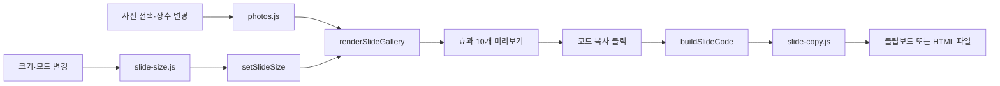

# CSS Motion Studio

문구와 사진을 바꿔 **텍스트 애니메이션 10종과 이미지 슬라이드 10종**을 비교하고, 선택한 설정을 코드로 가져갈 수 있는 프론트엔드 도구입니다.

## 제작 목적

웹페이지에서 자주 사용하는 텍스트 애니메이션을 HTML5와 CSS3로 직접 제작하고 모음집으로 정리했습니다. 개별 예제를 보는 데서 끝나지 않고, 다른 사람도 원하는 효과를 골라 자신의 웹페이지에 사용할 수 있도록 제공하는 것이 목표입니다.

이를 위해 **효과 선택 → 내용과 스타일 변경 → 미리보기 → 코드 복사**의 흐름을 만들었습니다. 사용자는 자신의 문구와 글꼴, 크기, 색상으로 결과를 확인한 뒤 해당 설정이 포함된 코드를 가져갈 수 있습니다. 같은 방식으로 이미지 슬라이드도 비교하고 재사용할 수 있도록 기능을 확장했습니다.

현재는 독립적으로 실행되는 모션 모음집입니다. 웹에디터 메뉴와의 실제 연결은 향후 구현할 계획이며, 이 프로젝트에서는 효과를 비교하고 설정 결과를 내보내는 기반 기능을 구현했습니다.

## 주요 기능

### 글자 모션

- 같은 문구로 10개 애니메이션 비교 및 효과별 다시 재생
- 한글과 이모지를 포함한 최대 80자 입력
- 기본 고딕·명조·고정폭 선택, 설치된 글꼴 이름 직접 지정
- WOFF2·WOFF·TTF·OTF 글꼴 파일 적용: 파일당 최대 30MB
- 글자 크기 8~240px, 색상표 또는 HEX 코드로 색상 지정
- 문구·글꼴·크기·색상이 포함된 HTML·CSS 코드 복사

크기와 색상을 조절할 때는 기존 글자 요소의 스타일만 변경해 재생 중인 애니메이션을 다시 시작하지 않습니다. 문구 변경과 다시 재생은 글자 요소를 새로 구성합니다.

### 이미지 슬라이드

- 번호 탐색, 이전·다음, 페이드, 밀기, 아코디언 등 10개 효과 비교
- 기본 SVG 예시 3종 제공, 사용자 사진 일괄 선택 및 개별 교체
- 이미지 개수 1~10개 지정: 사진당 최대 10MB
- 장수를 줄여 숨긴 사진은 다시 늘렸을 때 복구
- 가로·세로 직접 입력: 각각 80~7,680px
- 화면 꽉 채우기: 사용 가능한 너비와 브라우저 화면 높이에 맞춤
- 현재 사진·효과·크기 설정을 포함한 HTML·CSS·JavaScript 코드 복사

복사본에는 비교 화면의 제목·설명·카드 테두리가 포함되지 않습니다. 필요한 조작 버튼은 이미지 바로 아래 오른쪽에 배치되고, 사진이 한 장이면 조작 버튼을 생략합니다. 자동 복사가 제한되면 직접 복사하거나 HTML 파일로 저장할 수 있습니다.

## 사용 기술

| 기술 | 사용한 부분 |
| --- | --- |
| HTML5 | 입력 폼, 페이지 구조, 코드 복사 대화상자 |
| CSS3 | `@keyframes`, 전환 효과, 반응형 배치, 동작 줄이기 대응 |
| JavaScript | 입력 상태, DOM 생성, 사진·글꼴 처리, 코드 생성 및 복사 |
| SVG | 기본 이미지 슬라이드 예시와 아이콘 |
| Node.js | 슬라이드 복사용 자산을 갱신하는 개발용 스크립트 |

브라우저 실행에는 프레임워크나 외부 JavaScript 라이브러리가 필요하지 않습니다. 별도 백엔드·데이터베이스 없이 동작하며, 선택한 사진과 글꼴은 브라우저 안에서 처리합니다.

## 실행 방법

저장소를 내려받은 뒤 `dist/index.html`을 브라우저에서 열면 바로 사용할 수 있습니다. 별도의 패키지 설치나 빌드 과정은 필요하지 않습니다.

Python이 설치되어 있다면 프로젝트 루트에서 로컬 서버로 실행할 수도 있습니다.

```bash
python -m http.server 8000 --directory dist
```

- [글자 모션 열기](http://localhost:8000/index.html)
- [이미지 슬라이드 열기](http://localhost:8000/slides.html)

## 파일 구성

`dist/`에는 브라우저에서 사용하는 HTML·CSS·JavaScript와 이미지가 들어 있습니다. `scripts/`는 개발 중 복사용 자산을 갱신할 때 사용합니다.

```text
css-motion-studio/
├── dist/
│   ├── index.html               # 글자 모션 페이지
│   ├── effects.js               # 원본 글자 효과와 키프레임 데이터
│   ├── studio.js                # 문구·글꼴·스타일·재생·코드 복사
│   ├── studio.css               # 공통 화면 및 글자 모션 스타일
│   ├── slides.html              # 이미지 슬라이드 페이지
│   ├── slides.js                # 슬라이드 렌더링과 복사 코드 생성
│   ├── slides.css               # 슬라이드 배치와 효과별 스타일
│   ├── slide-keyframes.css      # 원본 슬라이드 키프레임
│   ├── photos.js                # 사진·장수·슬롯 교체 상태 관리
│   ├── photos.css               # 사진 설정 화면 스타일
│   ├── slide-size.js            # 크기 입력 검사와 모드 전환
│   ├── slide-size.css           # 크기 설정 화면 스타일
│   ├── slide-copy.js            # 클립보드·직접 복사·HTML 저장
│   ├── slide-export-assets.js   # 자동 생성된 복사용 CSS·SVG 묶음
│   ├── slide-tide.svg           # 물결 예시
│   ├── slide-orbit.svg          # 궤도 예시
│   └── slide-fold.svg           # 접힌 면 예시
├── scripts/
│   └── build-slide-export.mjs   # 복사용 자산 생성
└── README.md
```

## 동작 구조

### 텍스트: 효과 데이터와 화면 로직 분리

`index.html`은 `effects.js`를 먼저 읽고 `studio.js`를 실행합니다. `effects.js`가 효과 이름과 CSS를 제공하면, `studio.js`가 입력값에 맞는 글자 요소와 미리보기 카드 10개를 생성합니다.

1. `graphemes()`가 문구를 글자 단위로 나눕니다. `Intl.Segmenter` 지원 환경에서는 한글과 결합된 이모지 등을 구분합니다.
2. `motionText()`가 글자마다 `<span>`을 만들고 원본의 18개 동작 패턴을 순서대로 배정합니다. 19번째 글자부터 같은 패턴을 반복합니다.
3. `applyAppearance()`가 크기와 색상을 적용합니다. 폰트 선택과 파일 업로드는 별도로 관리합니다.
4. `exportMarkup()`이 현재 문구와 효과의 HTML·CSS를 생성합니다. 선택한 스타일은 모션 요소에 지정해 다른 설정의 복사본과 함께 사용해도 유지됩니다.

### 이미지: 입력 관리와 렌더링 분리



사진은 `URL.createObjectURL()`로 미리보기에 연결합니다. 교체하거나 초기화한 사진의 임시 URL은 해제하고, 장수를 줄여 숨긴 사진은 다시 사용할 수 있도록 보관합니다. 사진 개수가 달라지면 `slides.js`가 필요한 패널 수와 애니메이션 시간을 조정합니다.

코드 복사 시에는 선택한 효과와 사진·크기 설정을 먼저 보관합니다. 사진은 Data URL로 포함해 원래 페이지의 임시 URL이 사라져도 복사본에서 표시되도록 합니다. 동적 키프레임에는 고유 이름을 붙여 서로 다른 장수의 슬라이드를 한 페이지에서 사용할 수 있게 했습니다.

## 코드 수정과 복사용 자산 갱신

슬라이드 CSS, 키프레임 또는 기본 SVG를 수정했다면 프로젝트 루트에서 다음 명령을 실행합니다. Node.js가 필요하며 추가 패키지는 설치하지 않습니다.

```bash
node scripts/build-slide-export.mjs
```

이 스크립트는 `slides.css`, `slide-keyframes.css`, 기본 SVG 3개를 읽어 `dist/slide-export-assets.js`를 다시 만듭니다. 미리보기만 바뀌고 복사 코드에는 이전 스타일이 남는 일을 방지하기 위한 과정입니다. 생성된 파일을 직접 수정하기보다는 원본 CSS·SVG를 수정한 뒤 다시 생성합니다.

## 사용 시 알아둘 점

- 사진·글꼴·설정은 서버에 저장하지 않으므로 새로고침하면 초기화됩니다.
- 이름으로 지정한 글꼴은 결과를 보는 기기에 설치되어 있어야 합니다. 업로드한 글꼴은 복사 코드에 포함됩니다.
- 사진과 글꼴 파일을 포함한 복사 코드는 파일 크기에 따라 길어질 수 있습니다.
- 이미지의 직접 입력 크기는 이미지 영역 기준입니다. 좁은 영역에서는 비율을 유지해 줄어들며, 목록에서는 축소 미리보기를 표시합니다.
- 화면 꽉 채우기 모드는 이미지 아래 조작 버튼까지 브라우저 화면 높이에 포함합니다.
- 기기의 `prefers-reduced-motion` 설정을 반영해 움직임을 줄이고, 슬라이드는 버튼으로 장면을 확인할 수 있게 했습니다.
- 외부 사진이나 글꼴을 넣어 코드를 배포할 때는 해당 자료의 사용·재배포 조건을 확인해야 합니다.

## 제작 범위와 향후 계획

원본 텍스트 애니메이션과 이미지 슬라이드의 CSS는 직접 작성했습니다. 기존 키프레임을 기반으로 사용자 입력과 코드 내보내기를 연결했으며, 화면 구성·기능 확장·예시 SVG 제작에는 AI 개발 보조 도구를 활용했습니다.

향후에는 이 효과 목록을 웹에디터의 애니메이션 메뉴로 연결하고, 에디터에서 선택한 요소에 효과와 스타일 설정을 적용하는 흐름으로 확장할 계획입니다.

## 라이선스

현재 별도 라이선스를 지정하지 않았습니다.
